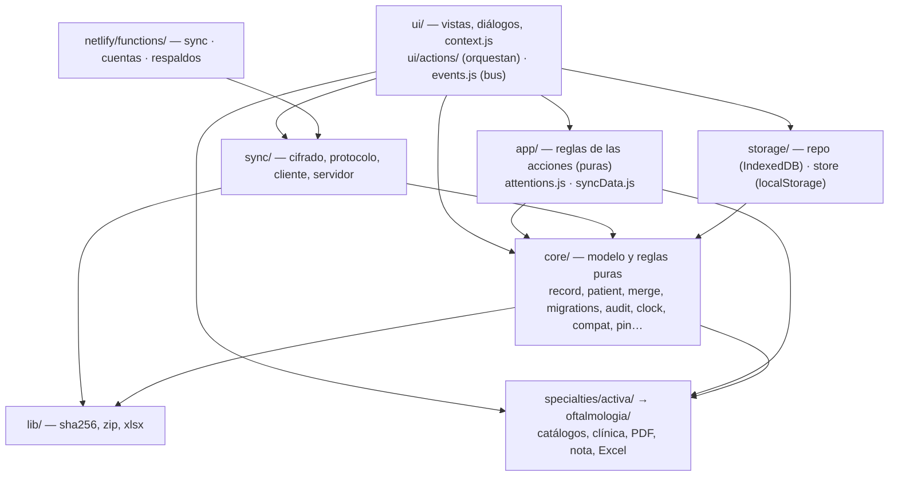

# Arquitectura

Las decisiones de fondo, con su porqué, están en el [registro de decisiones (ADR)](adr/README.md).

## Restricciones que guían el diseño

1. **Sin conexión y sin instalación.** Se usa en terreno (Rapa Nui), a veces sin internet, abriendo un archivo con doble clic (`file://`). Por eso el producto final es **un único HTML** con todo incrustado: código, estilos, pdf-lib y la plantilla PDF.
2. **Datos sensibles.** Los datos de pacientes no salen del equipo **sin cifrar**. La política CSP (`connect-src 'self'`) solo permite conectarse con el propio servidor. A ese servidor llegan únicamente atenciones cifradas en el PC (ver [SINCRONIZACION.md](SINCRONIZACION.md)).
3. **Varios PC a la vez.** Cada PC es la fuente de verdad local (*local-first*). La sincronización fusiona **campo a campo**: en cada campo gana la edición más reciente (ADR 0003). Así dos profesionales pueden registrar datos distintos del mismo paciente a la vez sin perder nada. Igual funciona la unión de respaldos.
4. **Mantenible.** El código fuente está en módulos ES pequeños con responsabilidades claras. Un *build* los une en el HTML final.

## Capas

El mapa completo y generado (capas, qué usa cada una, módulos y paquetes externos) está en [DEPENDENCIAS.md](DEPENDENCIAS.md). `npm run deps` revisa que no haya ciclos ni dependencias no permitidas, y las pruebas lo exigen.

Cada flecha es una dependencia permitida (ESLint impide las demás: las capas puras no tocan el DOM, y la plataforma solo ve la especialidad a través de `specialties/activa/`).



- **`app/` es la capa de aplicación:** las reglas de negocio de las acciones (preparar un guardado, preingresar, re-vincular una atención, actualizar la ficha del paciente) como funciones puras. `ui/actions/` solo orquesta: confirma con el usuario, persiste y re-dibuja. Así cada regla se prueba en Node (`tests/app.test.js`).
- **`core/`, `app/` y `lib/` no tocan el DOM ni `localStorage`.** Reciben datos y devuelven datos, así que se prueban directamente en Node (`tests/`).
- **Almacenamiento:**
  - `storage/repo.js` maneja los datos clínicos (atenciones, fichas de pacientes, eliminaciones, bitácora). Los mantiene en memoria y persiste en **IndexedDB** solo lo que cambió (`storage/backends.js`, con localStorage como respaldo).
  - `storage/store.js` guarda lo pequeño: ajustes, catálogos, borrador y sincronización. Recibe el `storage` por parámetro, y en las pruebas se usa uno en memoria (IndexedDB simulado con `fake-indexeddb`).
  - **Escrituras resilientes:** una escritura que falla se reintenta (retroceso corto). Si sigue fallando, NO se da por guardada: queda pendiente y se reintenta en cada `flush` y cada minuto, mientras los datos siguen en memoria. Al abrir, la app pide al navegador almacenamiento persistente.
  - **Rendimiento medido:** guardar una atención toma unos 25 ms; una sincronización sin cambios con 20.000 atenciones, unos 140 ms (solo pide lo cambiado); la descarga inicial de 3.000 atenciones, unos 0,3 s.
- **`ui/context.js`** guarda el estado (atención en edición, registros, filtro, ajustes) y lo transversal (persistir, re-dibujar, pestañas). Las acciones están en **`ui/actions/`**: `attention.js` (guardar, abrir, eliminar), `patients.js` (preingreso, fichas, unir duplicados), `catalogs.js` y `outputs.js` (PDF, nota). Las vistas llaman a esas acciones; nunca escriben en el almacenamiento directamente.
- **HTML seguro** (`ui/html.js`): toda la interfaz arma su HTML con la plantilla `html\`…\``, que escapa sola cada dato interpolado, y lo escribe con `setHtml`. ESLint prohíbe asignar `innerHTML` directamente, así que un nombre de paciente con `<` o `&` nunca se interpreta como HTML.

- **Cuentas de usuario** ([ADR 0014](adr/0014.md)):
  - reglas puras en `core/accounts.js`, `core/permissions.js` y `core/accessLog.js`;
  - criptografía del PC en `sync/accountCrypto.js`, y la **sesión** (entrar con y sin conexión, crear la clave, renovar, salir, activar, cola del registro) en `sync/accountSession.js`, sin pantalla y probada contra el servidor en memoria;
  - servidor en `sync/accounts.js` (función `cuentas`), y la sincronización exige su sesión;
  - interfaz: `ui/accounts.js` (solo pantallas: ingreso, crear la clave, tarjeta de la sesión), `ui/usersView.js`, `ui/auditView.js` y `ui/permissionsView.js`;
  - `ui/guard.js` mantiene el ingreso y el bloqueo por encima de cualquier diálogo.

- **Lógica separada de la pantalla:**
  - la sincronización tiene su motor en `ui/syncController.js` (cuándo y cómo sincronizar, activar, estado), que avisa con `onChange` y `notify`;
  - su vista está en `ui/syncView.js`;
  - lo mismo pasa con la sesión de las cuentas (`sync/accountSession.js` y `ui/accounts.js`).
- **Piezas compartidas de la interfaz:**
  - `ui/icons.js` (íconos);
  - `ui/patientFields.js` y `src/partials/paciente.html`: los datos del paciente, una sola plantilla para Ingreso y Atención;
  - `ui/menu.js`, `ui/guard.js` y `ui/settingsSections.js`.
- **Servicios del contexto:** se declaran todos en `ui/context.js` (cuentas, bloqueo, sincronización, permisos…) y los asigna `main.js` al arrancar. Ninguna vista agrega propiedades nuevas.
- **Contrato del contexto** (`ui/contract.d.ts`, desde 2.32.0): las acciones de `ui/actions/` y el servicio de cuentas declaran su forma ahí. Cada módulo indica con `@returns` qué parte cumple y el verificador de tipos lo comprueba.
  - Así las acciones reciben el contexto completo con su tipo (`AppContext`), no `any`.
  - Deducirlo con `ReturnType` sería circular, porque el contexto incluye las acciones.
  - Al quitar el `any` aparecieron 20 inconsistencias reales: la atención en blanco aceptaba cualquier texto como ojo; la configuración de sincronización con cuentas no declaraba `mode`; el bloqueo no declaraba `render`; y había ids que podían ser nulos sin revisarse.
- **Datos que llegan de afuera** (respaldos, adjuntos, archivo de la llave del PC, contrato de la especialidad) se revisan con guardas de tipo (`core/guards.js`, `isRecord`) en vez de convertirlos a `any`.

- **Paciente como unidad** (`core/patient.js`): cada atención es un episodio vinculado a la ficha de su paciente (`pacienteId`). Ver [MODELO_DATOS.md](MODELO_DATOS.md).

- **Bus de eventos** (`ui/events.js`): las acciones y la sincronización anuncian qué cambió (`ctx.emit(TOPICS.DATOS)`) en vez de llamar a cada vista. Los temas son una lista cerrada (`TOPICS`: datos, atención, adjuntos, cuenta, y `tabTopic(id)` al mostrar una pestaña), con su tipo: un nombre mal escrito no pasa la revisión de tipos. Las vistas se suscriben, y los avisos de un mismo momento se agrupan: una sincronización que recibe 50 atenciones dibuja las listas una sola vez.

Flujo típico: `evento → acción del contexto → store → render de las vistas afectadas`.

## Decisiones

| Decisión | Motivo |
|---|---|
| Escritor `.xlsx` propio (`lib/xlsx.js`) en vez de SheetJS | Unas 250 líneas contra ~1 MB de librería. Solo necesitamos texto, números, negrita, anchos y filtros. Se valida en los tests con el `zipfile` de Python como lector independiente. |
| ZIP propio, sin compresión (`lib/zip.js`) | Los PDF ya vienen comprimidos. Es simple y sin dependencias. |
| SHA-256/HMAC propio (`lib/sha256.js`) | `crypto.subtle` no está garantizado en `file://` en todos los navegadores. Se compara contra `node:crypto` en los tests. |
| pdf-lib empaquetado con esbuild | Es la misma librería que usaba la v1, ahora como dependencia versionada (1.17.1) y no pegada a mano. |
| Plantilla PDF como asset | Se edita o reemplaza como archivo (`assets/`). El build la incrusta en base64. |
| Mismas claves de `localStorage` que la v1 | Las atenciones existentes se leen sin migración manual (`normalizeRecord` las actualiza). |
| Validación con «errores» y «advertencias» | En terreno los datos pueden quedar incompletos. Solo se bloquea si falta lo mínimo (nombre/RUT y fecha). |

## Cambiar la plantilla PDF

Los nombres de los campos del PDF deben coincidir con las claves de `config/catalogs.js` (casillas) y con los que usa `pdf/attentionPdf.js` (textos). Para listar los campos de una plantilla nueva:

```bash
node -e "import('pdf-lib').then(async({PDFDocument})=>{const d=await PDFDocument.load(require('fs').readFileSync('assets/plantilla_hoja_atencion.pdf'));d.getForm().getFields().forEach(f=>console.log(f.constructor.name,f.getName()))})"
```

Un campo que falta en la plantilla se ignora sin error.

## Tests

`npm test` corre `node:test` sobre `tests/*.test.js`:

| Archivo | Cubre |
|---|---|
| `lib.test.js` | SHA-256/HMAC contra `node:crypto`, CRC-32, ZIP y XLSX leídos con Python |
| `core.test.js` | formato (RUT, fechas, texto), modelo, validación, derivaciones clínicas, nota |
| `stats.test.js` | filtros, agregados, grupos etarios, libro de estadística |
| `anonymize.test.js` | códigos estables, limpieza de textos, opciones, que no queden identificadores en la salida |
| `storage.test.js` | store en memoria, compatibilidad v1, errores de cuota, respaldo y unión |
| `pdf.test.js` | relleno de campos, casillas, hoja complementaria, aplanado |
| `build.test.js` | HTML único, CSP, sin recursos externos, sitio con service worker |
| `sync.test.js` | cifrado (clave incorrecta o datos alterados fallan), servidor (autenticación, validación, versiones), 4 PC que convergen sin que el servidor vea datos |

La interfaz (DOM) se verifica manualmente abriendo `dist/` en el navegador: guardar, validar, registro, estadística y cada exportación.
