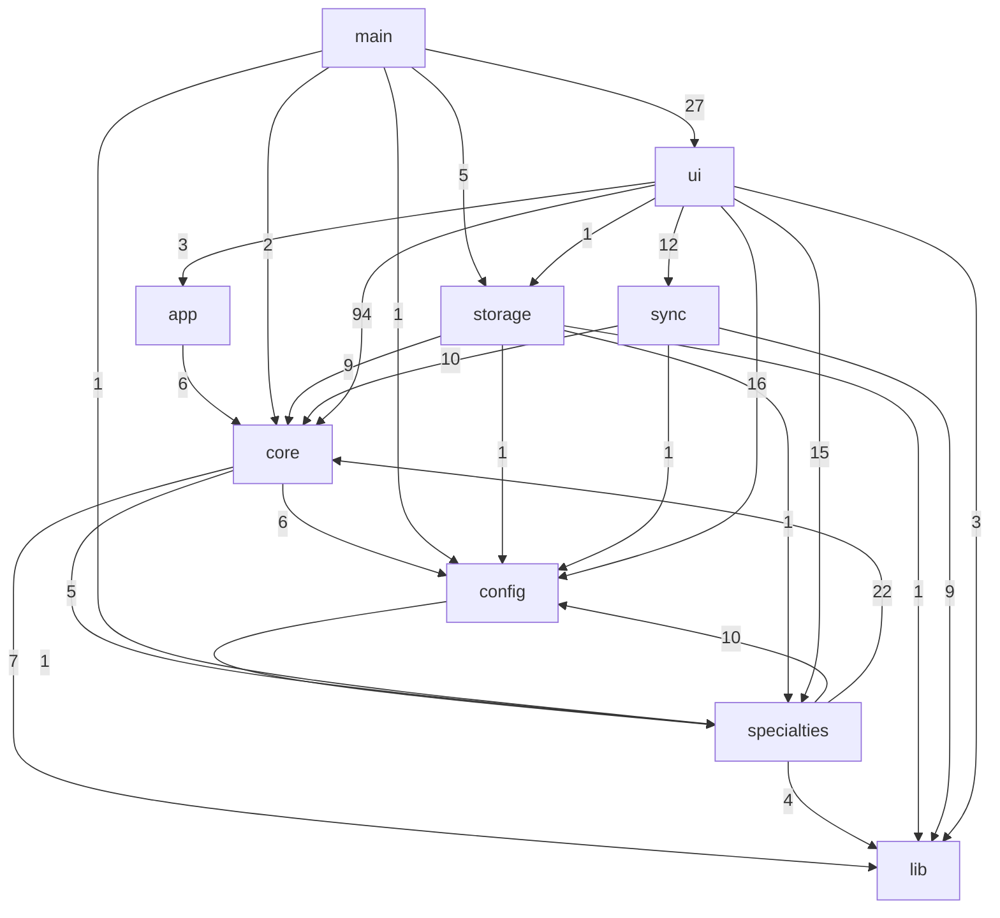

# Dependencias

> Generado por `npm run deps -- --write` (scripts/deps.mjs). La prueba `tests/deps.test.js` falla si aparece un ciclo, una dependencia entre capas no permitida o un paquete externo sin documentar.

Estado: **0 ciclos**, **0 dependencias no permitidas**, 135 módulos.

## Capas y qué puede usar cada una

| Capa | Qué contiene | Puede depender de |
|---|---|---|
| `lib/` | utilidades sin dominio (sha256, zip, xlsx) | — (nada) |
| `config/` | catálogos y claves de almacenamiento | `specialties` |
| `specialties/` | la especialidad: catálogos, clínica, PDF, nota, Excel | `core`, `lib`, `config` |
| `core/` | modelo y reglas puras | `lib`, `config`, `specialties` |
| `app/` | reglas de las acciones (puras) | `core`, `lib`, `config`, `specialties` |
| `storage/` | IndexedDB y localStorage | `core`, `lib`, `config`, `specialties` |
| `sync/` | cifrado, protocolo, cliente, servidor, cuentas | `core`, `lib`, `config` |
| `ui/` | pantallas, acciones y servicios de la interfaz | `app`, `sync`, `core`, `storage`, `lib`, `config`, `specialties` |
| `main.js` | punto de entrada | todas |

Además: `core/`, `app/`, `lib/`, `sync/` y `config/` no tocan el DOM ni el almacenamiento del navegador (lo impide ESLint), y la plataforma ve la especialidad solo a través de `specialties/activa/`.

## Dependencias reales entre capas

Cada flecha es una capa que usa a otra (el número: cuántos `import` hay).

## Paquetes externos

Pocos y con versión fija en `package.json` (sin `^` ni `~`). Dependabot propone las actualizaciones, y cada una pasa por las pruebas antes de aceptarse.

| Paquete | Versión | Tipo | Para qué | Dónde |
|---|---|---|---|---|
| `@netlify/blobs` | 11.1.9 | servidor | Almacén del servidor: sincronización, cuentas, registro de accesos y respaldos. | Solo en el servidor (funciones de Netlify) y en los scripts de operación. |
| `@playwright/test` | 1.65.1 | desarrollo y build | Pruebas de punta a punta (e2e/) y medir la app en un navegador real (npm run perf). | Solo en desarrollo y en la integración continua; nunca va dentro de la app. |
| `esbuild` | 0.25.10 | desarrollo y build | Empaquetar la app en un solo archivo HTML. | Solo al construir (scripts/build.mjs). |
| `eslint` | 10.15.0 | desarrollo y build | Revisión del código (npm run lint) e informe de calidad (npm run calidad). | Solo en desarrollo y en la integración continua; nunca va dentro de la app. |
| `pdf-lib` | 1.17.1 | desarrollo y build | Llenar la plantilla PDF de la atención y armar el PDF con anexos. | Va dentro de la app (el build la incluye en el HTML). |

Herramientas de desarrollo que no se importan desde el código: `@axe-core/playwright` 4.14.0, `@eslint/js` 10.0.1, `@types/node` 22.19.3, `fake-indexeddb` 6.2.8, `globals` 17.14.0, `prettier` 3.10.1, `typescript` 5.9.3.

## Módulos por capa

Para cada módulo: cuántos módulos usa (→) y cuántos lo usan (←).

### main.js (1)

`main.js` →36 ←0

### lib/ (4)

`lib/async.js` →0 ←2 · `lib/sha256.js` →0 ←13 · `lib/xlsx.js` →1 ←7 · `lib/zip.js` →0 ←3

### config/ (2)

`config/catalogs.js` →1 ←33 · `config/gesCatalog.js` →0 ←2

### specialties/ (28)

`specialties/activa/config.js` →1 ←9 · `specialties/activa/gesPlantilla.js` →1 ←1 · `specialties/activa/index.js` →1 ←8 · `specialties/activa/ipdPlantilla.js` →1 ←1 · `specialties/activa/plantilla.js` →1 ←1 · `specialties/activa/recetaPlantilla.js` →1 ←2 · `specialties/activa/validacion.js` →1 ←1 · `specialties/contrato.js` →1 ←0 · `specialties/oftalmologia/clinica.js` →1 ←6 · `specialties/oftalmologia/config.js` →0 ←8 · `specialties/oftalmologia/ejemplos.js` →0 ←1 · `specialties/oftalmologia/estadistica.js` →5 ←3 · `specialties/oftalmologia/index.js` →9 ←1 · `specialties/oftalmologia/nota.js` →3 ←1 · `specialties/oftalmologia/pdf.js` →4 ←1 · `specialties/oftalmologia/reportes.js` →6 ←1 · `specialties/oftalmologia/seudonimizacion.js` →8 ←1 · `specialties/oftalmologia/validacion.js` →2 ←2 · `specialties/orl/clinica.js` →1 ←6 · `specialties/orl/config.js` →0 ←7 · `specialties/orl/ejemplos.js` →0 ←1 · `specialties/orl/estadistica.js` →6 ←2 · `specialties/orl/index.js` →9 ←0 · `specialties/orl/nota.js` →3 ←1 · `specialties/orl/pdf.js` →5 ←1 · `specialties/orl/reportes.js` →6 ←1 · `specialties/orl/seudonimizacion.js` →8 ←1 · `specialties/orl/validacion.js` →2 ←1

### core/ (29)

`core/accessLog.js` →0 ←1 · `core/accounts.js` →1 ←8 · `core/attachments.js` →3 ←7 · `core/audit.js` →2 ←8 · `core/backup.js` →10 ←1 · `core/catalog.js` →6 ←9 · `core/clinicalForms.js` →1 ←5 · `core/clock.js` →0 ←11 · `core/compat.js` →0 ←3 · `core/demo.js` →4 ←1 · `core/errlog.js` →1 ←1 · `core/estadistica.js` →1 ←3 · `core/fields.js` →1 ←3 · `core/format.js` →0 ←44 · `core/ges.js` →3 ←3 · `core/guards.js` →0 ←7 · `core/ipd.js` →5 ←1 · `core/merge.js` →6 ←6 · `core/migrations.js` →2 ←4 · `core/names.js` →0 ←19 · `core/patient.js` →5 ←13 · `core/pdfAnexos.js` →1 ←1 · `core/pdfTexto.js` →1 ←2 · `core/permissions.js` →0 ←3 · `core/pin.js` →1 ←1 · `core/pseudonym.js` →3 ←5 · `core/receta.js` →4 ←1 · `core/record.js` →6 ←21 · `core/serverBackup.js` →1 ←1

### app/ (2)

`app/attentions.js` →4 ←2 · `app/syncData.js` →2 ←1

### storage/ (5)

`storage/backends.js` →0 ←2 · `storage/pcVault.js` →2 ←1 · `storage/repo.js` →7 ←1 · `storage/sealed.js` →2 ←2 · `storage/store.js` →3 ←2

### sync/ (18)

`sync/accountCrypto.js` →3 ←3 · `sync/accounts.js` →8 ←0 · `sync/accounts/admin.js` →4 ←1 · `sync/accounts/http.js` →1 ←4 · `sync/accounts/login.js` →7 ←1 · `sync/accounts/secrets.js` →4 ←3 · `sync/accounts/session.js` →3 ←1 · `sync/accounts/store.js` →1 ←3 · `sync/accounts/validate.js` →3 ←5 · `sync/accountsApi.js` →1 ←3 · `sync/accountSession.js` →6 ←1 · `sync/attachments.js` →3 ←1 · `sync/attempts.js` →1 ←3 · `sync/backup.js` →1 ←1 · `sync/client.js` →3 ←3 · `sync/crypto.js` →1 ←12 · `sync/protocol.js` →1 ←4 · `sync/server.js` →6 ←0

### ui/ (46)

`ui/accounts.js` →18 ←1 · `ui/actions/attachments.js` →7 ←1 · `ui/actions/attention.js` →12 ←2 · `ui/actions/catalogs.js` →6 ←1 · `ui/actions/forms.js` →16 ←1 · `ui/actions/outputs.js` →9 ←1 · `ui/actions/patients.js` →15 ←1 · `ui/attachmentsView.js` →5 ←2 · `ui/attentionView.js` →12 ←7 · `ui/auditView.js` →10 ←1 · `ui/busy.js` →3 ←3 · `ui/catalogView.js` →11 ←5 · `ui/checkView.js` →6 ←1 · `ui/clinicalForm.js` →5 ←3 · `ui/context.js` →22 ←1 · `ui/dialog.js` →2 ←6 · `ui/dom.js` →0 ←32 · `ui/errorLog.js` →2 ←5 · `ui/events.js` →1 ←14 · `ui/exportView.js` →10 ←2 · `ui/gesDialog.js` →7 ←1 · `ui/guard.js` →0 ←2 · `ui/headerFit.js` →0 ←1 · `ui/html.js` →1 ←24 · `ui/icons.js` →1 ←5 · `ui/images.js` →0 ←2 · `ui/intakeView.js` →9 ←2 · `ui/ipdDialog.js` →10 ←1 · `ui/lock.js` →6 ←1 · `ui/menu.js` →1 ←4 · `ui/modal.js` →2 ←13 · `ui/patientFields.js` →3 ←6 · `ui/permissionsView.js` →3 ←1 · `ui/practice.js` →4 ←3 · `ui/recetaDialog.js` →5 ←1 · `ui/registryView.js` →7 ←2 · `ui/rut.js` →2 ←3 · `ui/settingsSections.js` →2 ←1 · `ui/settingsView.js` →8 ←3 · `ui/statsView.js` →4 ←2 · `ui/syncController.js` →10 ←2 · `ui/syncView.js` →7 ←1 · `ui/updateNotice.js` →2 ←1 · `ui/usersView.js` →15 ←1 · `ui/userView.js` →12 ←2 · `ui/version.js` →1 ←2

